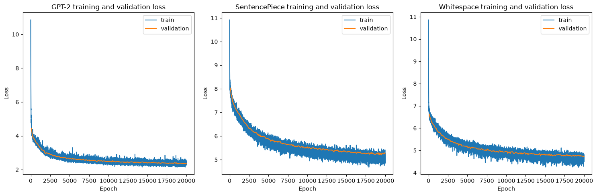
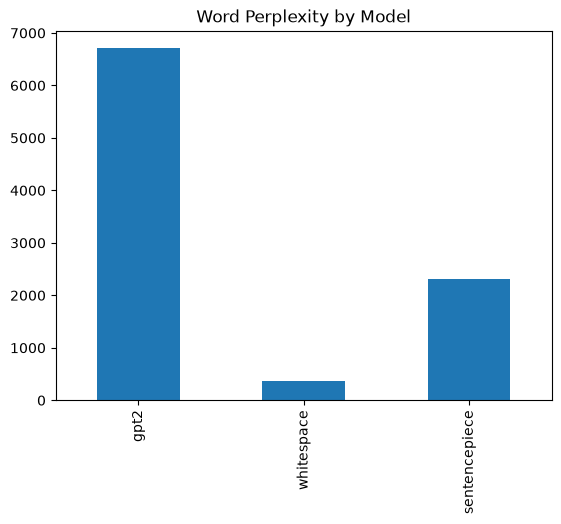
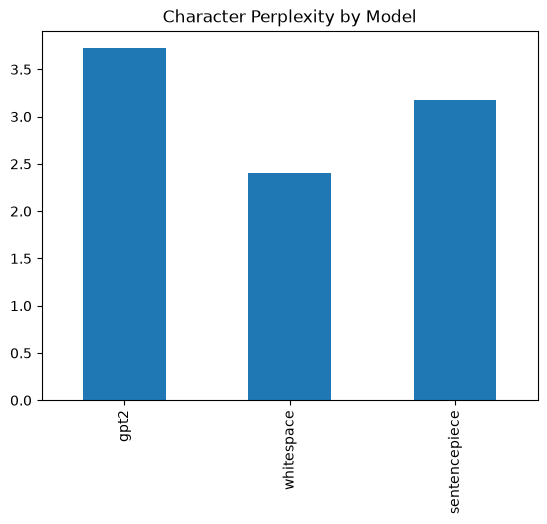
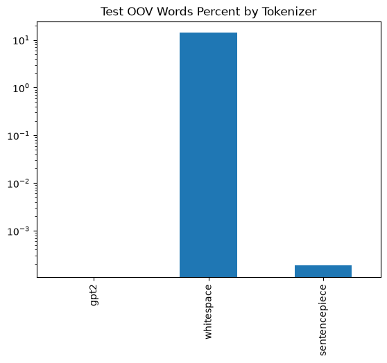
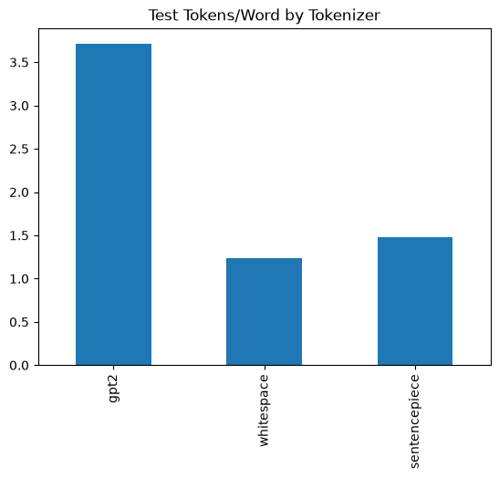
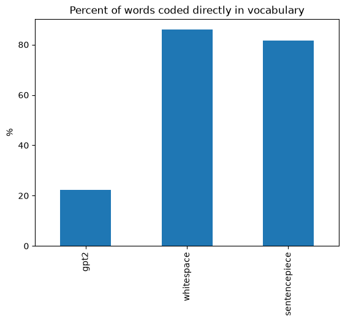

# Tokenization Efficiency Benchmark for Polish Text

## 1. Dataset and Corpus Split

I used the `wolne_lektury` dataset from `SpeakLeash` as my corpus. The training, validation, and test splits were prepared using `prepare_dataset.py`, 
with assignment proportions of 90% / 5% / 5%. I kept each document within a single split.

Documents from `SpeakLeash` were concatenated into single text files with double newlines separating individual documents.

| Split | UTF-8 size [MB] | Number of words* | Purpose |
| --- | --- | --- | --- |
| Training | 246 | 36567381 | Building the whitespace vocabulary and training SentencePiece and the language models |
| Validation | 15 | 2093321 | Monitoring loss during training |
| Test | 12 | 1662640 | Computing final metrics and comparing tokenization |

\* Number of words as the output of `wc -w` command on txt files

## 2. Tokenizers

I implemented the `WhiteSpaceTokenizer` using the regular expression `\w+|[^\w\s]` to treat punctuation marks as separate tokens. I built its vocabulary from the most frequent training items and added the special `<UNK>` token.

I trained SentencePiece using BPE with `character_coverage=1.0` and `hard_vocab_limit=True`.

| Feature | GPT-2 BPE | Whitespace | SentencePiece |
| --- | --- | --- | --- |
| Algorithm | Pretrained byte-level BPE | Splitting into words and separate punctuation marks | BPE trained on the selected corpus |
| Implementation | `GPT2BPETokenizer`, Hugging Face `openai-community/gpt2` | Custom `WhiteSpaceTokenizer` class | `SentencePieceBPETokenizer`, SentencePiece library |
| Vocabulary size | 50,257 | 50,257, including `<UNK>` | 50,257, including special tokens |
| Vocabulary source | Pretrained tokenizer | Most frequent items in the training split | Training split |
| Handling unknown words | Splitting into smaller units represented by byte-level BPE | Replacing the word with `<UNK>` | Splitting into vocabulary units; unknown characters may require `<unk>` |

## 3. Hardware and Software Environment

| Component | Specification |
| --- | --- |
| GPU | NVIDIA GeForce RTX 3060 Ti |
| GPU memory | 8 GB VRAM |
| CPU | AMD Ryzen 7 7800X3D |
| RAM | 32 GB DDR5 |
| Operating system | WSL2 Fedora 43 / Windows 11|
| Python | 3.13.2 |
| Numerical precision | FP32 |

## 4. Model and Training Configuration

I used Andrej Karpathy's nanoGPT - simple implementation of GPT2. I copied the architecture and the training configuration specified in Karpathy's repository.
I wrote my own training script because the original one was overcomplicated for my purposes.

I trained all three models from scratch using the same architecture configuration and hyperparameters.

| Parameter | Value in `train.py` |
| --- | --- |
| Model vocabulary size | 50,257 |
| Number of transformer layers | 6 |
| Number of attention heads | 6 |
| Embedding dimension | 384 |
| Context length (`block_size`) | 256 tokens |
| Batch size | 16 |
| Dropout | 0.1 |
| `bias` parameter | `False` |
| Optimizer | AdamW |
| Learning rate | 0.0003 |
| Number of training steps | 20,000 |
| Learning rate schedule | Constant learning rate |
| Loss function | Cross-entropy for next-token prediction |
| Validation | Every 100 steps and once more after training |
| Batches per validation measurement | 20 |
| PyTorch random seed | 42 |
| Final model selection | Checkpoint after the final training step |

Training history for each tokenizer below:



We cannot compere loss values directly across tokenizers because token count will differ for the same text.

## 5. Evaluation

|               |   word_perplexity |   character_perplexity |   word_count |   character_count |   test_tokens |   tokens_per_word |   oov_word_count |   oov_words_percent |
|:--------------|------------------:|-----------------------:|-------------:|------------------:|--------------:|------------------:|-----------------:|--------------------:|
| gpt2          |           6708.07 |                3.72272 |  1.62194e+06 |       1.08722e+07 |   6.01693e+06 |           3.7097  |                0 |         0           |
| whitespace    |            359.24 |                2.40557 |  1.62194e+06 |       1.08722e+07 |   2.00437e+06 |           1.23578 |           227982 |        14.0561      |
| sentencepiece |           2319.37 |                3.17727 |  1.62194e+06 |       1.08722e+07 |   2.39855e+06 |           1.47881 |                3 |         0.000184963 |

### 5.2. Perplexity

#### Word Perplexity

The word perplexity measures how well the model predicts the next word in the sequence. Lower values indicate better predictive performance. From the table above, we can see that the whitespace tokenizer achieves the lowest word perplexity, followed by SentencePiece, with GPT-2 having the highest word perplexity. But for WhiteSpace with large
amount of \<UNK\> tokens the word perplexity might not fully reflect the model's performance.



#### Character Perplexity

The character perplexity measures how well the model predicts the next character in the sequence.



### 5.3. OOV and Word Representation

#### OOV (Out-of-Vocabulary) Tokens
This metric evaluates how much encoded tokens are outside-of-vocabulary for each tokenizer. (Amount of OOV token)



#### Word Representation

Tokens per word for each tokenizer:



As expected, tokenizers trained on Polish corpus are much more efficient. Also our custom word level tokenizer
is the most efficient while sentencepiece byte-level is able to represent more words indirectly - hence getting worse result - 
in Whitespace Tokenizer, unknown words are represented as single \<UNK\> token.

Number of words represented directly by tokens for each tokenizer:



### 5.4. Efficiency

|               |   tokens_per_second |
|:--------------|--------------------:|
| gpt2          |         1.30501e+06 |
| whitespace    |         5.79585e+06 |
| sentencepiece |    904528           |

We can see that the whitespace tokenizer processes tokens the fastest, followed by GPT-2, with SentencePiece being the slowest among the three.

## 7. Qualitative Analysis

Each of the three sample texts must contain at least 30 words according to the adopted definition. Use the same text for all tokenizers within each example. Present tokenization outputs as readable tokenizer units, preserving word-boundary markers and unknown tokens.

### 7.1. Example 1 — Common Vocabulary

Example text:

> Pewnego dnia młoda kobieta wyszła z domu i poszła do ogrodu. Na ławce pod starym drzewem czekał jej brat. 
  Razem patrzyli na niebo, rozmawiali o rodzinie i zastanawiali się, czy następnego ranka pogoda 
  pozwoli im wybrać się na długi spacer nad rzekę.

**GPT-2:**

```text
'P', 'ew', 'ne', 'go', 'Ġd', 'nia', 'Ġm', 'ÅĤ', 'oda', 'Ġk', 'ob', 'iet', 'a', 'Ġw', 'ys', 'z', 'ÅĤ', 'a', 'Ġz', 'Ġdom', 'u', 'Ġi', 'Ġpos', 'z', 'ÅĤ', 'a', 'Ġdo', 'Ġo', 'g', 'rodu', '.', 'ĠNa', 'ĠÅ', 'Ĥ', 'aw', 'ce', 'Ġpod', 'Ġst', 'ary', 'm', 'Ġdr', 'z', 'ew', 'em', 'Ġcz', 'eka', 'ÅĤ', 'Ġje', 'j', 'Ġbr', 'at', '.', 'ĠRaz', 'em', 'Ġpat', 'r', 'z', 'yl', 'i', 'Ġna', 'Ġn', 'ie', 'bo', ',', 'Ġro', 'z', 'm', 'aw', 'ial', 'i', 'Ġo', 'Ġrod', 'zin', 'ie', 'Ġi', 'Ġz', 'ast', 'an', 'aw', 'ial', 'i', 'Ġsi', 'Ä', 'Ļ', ',', 'Ġc', 'zy', 'Ġn', 'ast', 'Ä', 'Ļ', 'p', 'ne', 'go', 'Ġrank', 'a', 'Ġp', 'og', 'oda', 'Ġpo', 'z', 'w', 'oli', 'Ġim', 'Ġw', 'y', 'bra', 'Äĩ', 'Ġsi', 'Ä', 'Ļ', 'Ġna', 'Ġd', 'ÅĤ', 'ugi', 'Ġsp', 'acer', 'Ġn', 'ad', 'Ġr', 'zek', 'Ä', 'Ļ', '.'
```

**Whitespace:**

```text
'Pewnego', 'dnia', 'młoda', 'kobieta', 'wyszła', 'z', 'domu', 'i', 'poszła', 'do', 'ogrodu', '.', 'Na', 'ławce', 'pod', 'starym', 'drzewem', 'czekał', 'jej', 'brat', '.', 'Razem', 'patrzyli', 'na', 'niebo', ',', 'rozmawiali', 'o', 'rodzinie', 'i', '<UNK>', 'się', ',', 'czy', 'następnego', 'ranka', 'pogoda', 'pozwoli', 'im', 'wybrać', 'się', 'na', 'długi', 'spacer', 'nad', 'rzekę', '.'
```

**SentencePiece:**

```text
'▁Pewnego', '▁dnia', '▁młoda', '▁kobieta', '▁wyszła', '▁z', '▁domu', '▁i', '▁poszła', '▁do', '▁ogrodu', '.', '▁Na', '▁ławce', '▁pod', '▁starym', '▁drzewem', '▁czekał', '▁jej', '▁brat', '.', '▁Razem', '▁patrzyli', '▁na', '▁niebo', ',', '▁rozmawiali', '▁o', '▁rodzinie', '▁i', '▁zastanawi', 'ali', '▁się', ',', '▁czy', '▁następnego', '▁ranka', '▁pogoda', '▁pozwoli', '▁im', '▁wybrać', '▁się', '▁na', '▁długi', '▁spacer', '▁nad', '▁rzekę', '.'
```

|               |   test_tokens |   tokens_per_word |   direct_word_count |   direct_words_percent |
|:--------------|--------------:|------------------:|--------------------:|-----------------------:|
| gpt2          |           124 |           2.95238 |                  10 |                23.8095 |
| whitespace    |            47 |           1.11905 |                  41 |                97.619  |
| sentencepiece |            48 |           1.14286 |                  41 |                97.619  |

**Commentary:** [Describe differences in word segmentation, punctuation handling, and the occurrence of UNK.]

### 7.2. Example 2 — Proper Names and Rare Inflected Forms

Example text:

>  Podczas podróży przez Szczebrzeszyn i Hrubieszów Krzysztof Brzęczyszczykiewicz spotkał Zofię Żółkiewską oraz Grzegorza Przeździeckiego. Rozmawiali o nieprzewidywalności pogody, dziewięćdziesięciokilometrowej trasie i najrzadziej odwiedzanych miejscowościach. Wśród pożółkłych dokumentów odnaleźli nazwiska przodków, zapomniane przydomki oraz szczegółowe opisy wędrówek odbywanych niegdyś przez tamtejszych mieszkańców.

**GPT-2:**

```text
'Pod', 'cz', 'as', 'Ġpod', 'r', 'ó', 'Å', '¼', 'y', 'Ġpr', 'ze', 'z', 'ĠSz', 'c', 'ze', 'br', 'zes', 'z', 'yn', 'Ġi', 'ĠH', 'rub', 'ies', 'z', 'ó', 'w', 'ĠKr', 'z', 'ys', 'z', 'to', 'f', 'ĠBr', 'z', 'Ä', 'Ļ', 'cz', 'ys', 'z', 'c', 'zyk', 'iewicz', 'Ġspot', 'ka', 'ÅĤ', 'ĠZ', 'ofi', 'Ä', 'Ļ', 'ĠÅ', '»', 'ó', 'ÅĤ', 'k', 'iew', 'sk', 'Ä', 'ħ', 'Ġor', 'az', 'ĠGr', 'z', 'eg', 'or', 'za', 'ĠPr', 'ze', 'Å', 'º', 'd', 'zie', 'ck', 'ie', 'go', '.', 'ĠRoz', 'm', 'aw', 'ial', 'i', 'Ġo', 'Ġn', 'ie', 'pr', 'z', 'ew', 'idy', 'wal', 'no', 'Å', 'Ľ', 'ci', 'Ġp', 'og', 'ody', ',', 'Ġd', 'z', 'iew', 'i', 'Ä', 'Ļ', 'Äĩ', 'd', 'z', 'ies', 'i', 'Ä', 'Ļ', 'ci', 'ok', 'il', 'omet', 'ro', 'we', 'j', 'Ġtr', 'as', 'ie', 'Ġi', 'Ġn', 'aj', 'r', 'z', 'ad', 'zie', 'j', 'Ġod', 'w', 'ied', 'z', 'any', 'ch', 'Ġm', 'ie', 'j', 'sc', 'ow', 'o', 'Å', 'Ľ', 'ci', 'ach', '.', 'ĠW', 'Å', 'Ľ', 'r', 'ó', 'd', 'Ġpo', 'Å', '¼', 'ó', 'ÅĤ', 'k', 'ÅĤ', 'y', 'ch', 'Ġdo', 'k', 'ument', 'ó', 'w', 'Ġod', 'n', 'ale', 'Å', 'º', 'li', 'Ġn', 'az', 'w', 'isk', 'a', 'Ġpr', 'z', 'od', 'k', 'ó', 'w', ',', 'Ġz', 'ap', 'om', 'nian', 'e', 'Ġpr', 'zy', 'dom', 'ki', 'Ġor', 'az', 'Ġs', 'z', 'cz', 'eg', 'ó', 'ÅĤ', 'owe', 'Ġop', 'isy', 'Ġw', 'Ä', 'Ļ', 'dr', 'ó', 'we', 'k', 'Ġod', 'by', 'w', 'any', 'ch', 'Ġn', 'ieg', 'dy', 'Å', 'Ľ', 'Ġpr', 'ze', 'z', 'Ġtam', 'te', 'js', 'zy', 'ch', 'Ġm', 'ies', 'z', 'ka', 'Å', 'Ħ', 'c', 'ó', 'w', '.'
```

**Whitespace:**

```text
'Podczas', 'podróży', 'przez', '<UNK>', 'i', '<UNK>', 'Krzysztof', '<UNK>', 'spotkał', '<UNK>', '<UNK>', 'oraz', 'Grzegorza', '<UNK>', '.', 'Rozmawiali', 'o', '<UNK>', 'pogody', ',', '<UNK>', '<UNK>', 'i', '<UNK>', '<UNK>', 'miejscowościach', '.', 'Wśród', '<UNK>', 'dokumentów', '<UNK>', 'nazwiska', 'przodków', ',', 'zapomniane', '<UNK>', 'oraz', 'szczegółowe', 'opisy', 'wędrówek', '<UNK>', 'niegdyś', 'przez', 'tamtejszych', 'mieszkańców', '.'
```

**SentencePiece:**

```text
'▁Podczas', '▁podróży', '▁przez', '▁Szcze', 'brze', 'szyn', '▁i', '▁H', 'ru', 'bie', 'szów', '▁Krzysztof', '▁Brzę', 'czy', 'szczy', 'kiewicz', '▁spotkał', '▁Zo', 'fię', '▁Żół', 'kie', 'wską', '▁oraz', '▁Grzegorza', '▁Prze', 'ździe', 'ckiego', '.', '▁Rozmawi', 'ali', '▁o', '▁nieprzewi', 'dy', 'wal', 'ności', '▁pogody', ',', '▁dziewięć', 'dziesięcio', 'ki', 'lomet', 'rowej', '▁tra', 'sie', '▁i', '▁naj', 'rzadziej', '▁odwie', 'dzanych', '▁miejscowości', 'ach', '.', '▁Wśród', '▁pożół', 'kłych', '▁dokumentów', '▁odna', 'leźli', '▁nazwiska', '▁przodków', ',', '▁zapomniane', '▁przydom', 'ki', '▁oraz', '▁szczegółowe', '▁opisy', '▁wędrówek', '▁odby', 'wanych', '▁niegdyś', '▁przez', '▁tamtejszych', '▁mieszkańców', '.'
```

|               |   test_tokens |   tokens_per_word |   direct_word_count |   direct_words_percent |
|:--------------|--------------:|------------------:|--------------------:|-----------------------:|
| gpt2          |           237 |           5.78049 |                   3 |                7.31707 |
| whitespace    |            46 |           1.12195 |                  26 |               63.4146  |
| sentencepiece |            75 |           1.82927 |                  24 |               58.5366  |

**Commentary:** [Describe the representation of proper names and inflected words, and the information lost when words are replaced with UNK.]

### 7.3. Example 3 — Specialized Vocabulary or Text Outside the Training Domain


Example text:

> Administrator skonfigurował klaster Kubernetes, uruchomił kontenery i sprawdził opóźnienia komunikacji między mikroserwisami. Następnie zespół przeanalizował gradienty transformera, zastosował kwantyzację parametrów oraz porównał przepustowość tokenizera z wykorzystaniem procesora graficznego. Wyniki eksperymentu zapisano w repozytorium, a automatyczny monitoring zgłosił nieoczekiwany wzrost zużycia pamięci podczas inferencji.

**GPT-2:**

```text
'Administ', 'rator', 'Ġsk', 'on', 'fig', 'u', 'row', 'a', 'ÅĤ', 'Ġk', 'l', 'aster', 'ĠKu', 'ber', 'net', 'es', ',', 'Ġur', 'uch', 'omi', 'ÅĤ', 'Ġk', 'ont', 'enery', 'Ġi', 'Ġsp', 'raw', 'd', 'zi', 'ÅĤ', 'Ġop', 'ó', 'Å', 'º', 'n', 'ien', 'ia', 'Ġk', 'om', 'un', 'ik', 'ac', 'ji', 'Ġmi', 'Ä', 'Ļ', 'd', 'zy', 'Ġm', 'ik', 'ro', 'ser', 'w', 'is', 'ami', '.', 'ĠN', 'ast', 'Ä', 'Ļ', 'p', 'nie', 'Ġz', 'esp', 'ó', 'ÅĤ', 'Ġpr', 'ze', 'an', 'al', 'iz', 'owa', 'ÅĤ', 'Ġgradient', 'y', 'Ġtransform', 'era', ',', 'Ġz', 'ast', 'os', 'owa', 'ÅĤ', 'Ġk', 'want', 'yz', 'ac', 'j', 'Ä', 'Ļ', 'Ġparam', 'etr', 'ó', 'w', 'Ġor', 'az', 'Ġpor', 'ó', 'wn', 'a', 'ÅĤ', 'Ġpr', 'z', 'ep', 'ust', 'ow', 'o', 'Å', 'Ľ', 'Äĩ', 'Ġtoken', 'izer', 'a', 'Ġz', 'Ġw', 'yk', 'or', 'zy', 'st', 'ani', 'em', 'Ġpro', 'ces', 'ora', 'Ġgra', 'f', 'icz', 'ne', 'go', '.', 'ĠWyn', 'iki', 'Ġe', 'ks', 'per', 'y', 'ment', 'u', 'Ġz', 'ap', 'is', 'ano', 'Ġw', 'Ġrepo', 'zy', 'tor', 'ium', ',', 'Ġa', 'Ġautom', 'at', 'y', 'cz', 'ny', 'Ġmonitoring', 'Ġz', 'g', 'ÅĤ', 'osi', 'ÅĤ', 'Ġn', 'ie', 'oc', 'zek', 'iw', 'any', 'Ġw', 'z', 'rost', 'Ġz', 'u', 'Å', '¼', 'y', 'cia', 'Ġp', 'ami', 'Ä', 'Ļ', 'ci', 'Ġpod', 'cz', 'as', 'Ġinf', 'ere', 'nc', 'ji', '.'
```

**Whitespace:**

```text
'<UNK>', '<UNK>', '<UNK>', '<UNK>', ',', '<UNK>', '<UNK>', 'i', 'sprawdził', '<UNK>', 'komunikacji', 'między', '<UNK>', '.', 'Następnie', 'zespół', '<UNK>', '<UNK>', '<UNK>', ',', '<UNK>', '<UNK>', '<UNK>', 'oraz', 'porównał', '<UNK>', '<UNK>', 'z', '<UNK>', '<UNK>', '<UNK>', '.', '<UNK>', '<UNK>', '<UNK>', 'w', '<UNK>', ',', 'a', '<UNK>', '<UNK>', 'zgłosił', 'nieoczekiwany', 'wzrost', '<UNK>', 'pamięci', 'podczas', '<UNK>', '.'
```

**SentencePiece:**

```text
'▁A', 'dmi', 'ni', 'stra', 'tor', '▁skon', 'fi', 'gu', 'rował', '▁kla', 'ster', '▁Ku', 'ber', 'ne', 'tes', ',', '▁u', 'rucho', 'mił', '▁kon', 'te', 'ne', 'ry', '▁i', '▁spraw', 'dził', '▁opóź', 'nienia', '▁komunikacji', '▁między', '▁mikro', 'ser', 'wi', 'sami', '.', '▁Następnie', '▁ze', 'spół', '▁prze', 'anali', 'zował', '▁grad', 'ien', 'ty', '▁trans', 'for', 'mera', ',', '▁zastos', 'ował', '▁k', 'wan', 'ty', 'zację', '▁pa', 'ram', 'etrów', '▁oraz', '▁porów', 'nał', '▁przepu', 'st', 'owość', '▁to', 'ke', 'ni', 'zera', '▁z', '▁wyko', 'rzyst', 'aniem', '▁proce', 'so', 'ra', '▁g', 'rafi', 'cznego', '.', '▁Wy', 'niki', '▁eksperym', 'entu', '▁zapis', 'ano', '▁w', '▁re', 'pozy', 'torium', ',', '▁a', '▁automaty', 'czny', '▁mo', 'ni', 'tori', 'ng', '▁zgłosił', '▁nieoczeki', 'wany', '▁wzrost', '▁zuży', 'cia', '▁pamięci', '▁podczas', '▁in', 'feren', 'cji', '.'
```

|               |   test_tokens |   tokens_per_word |   direct_word_count |   direct_words_percent |
|:--------------|--------------:|------------------:|--------------------:|-----------------------:|
| gpt2          |           188 |           4.37209 |                   4 |                9.30233 |
| whitespace    |            49 |           1.13953 |                  16 |               37.2093  |
| sentencepiece |           108 |           2.51163 |                  12 |               27.907   |

## 8. Conclusions

The main conclusion from those experiments is that training custom tokenizer is beneficial if trying 
to handle domain-specific vocabulary and rare words more effectively. Tokens are a currency today and 
making their efficient use crucial for both model performance and computational cost.

Our word-level tokenizer in theory provided the best results, however its practical use can be limited due to strict
dependence on a fixed vocabulary - while sentencepiece with a cost of slightly increased token count can increase flexibility and handle rare words more gracefully.
